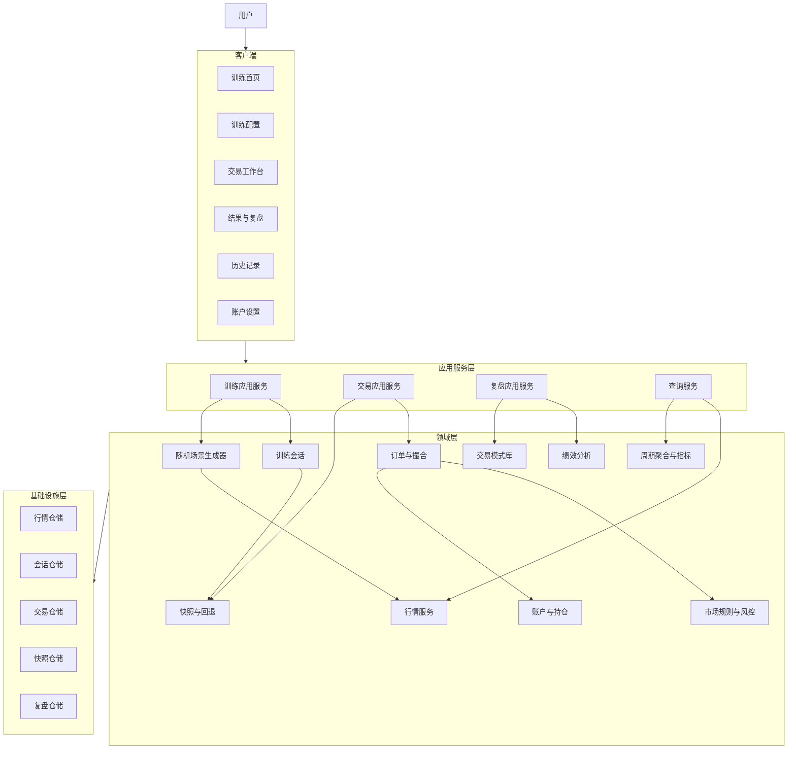
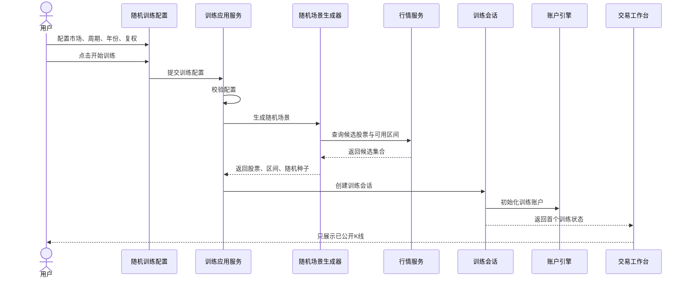
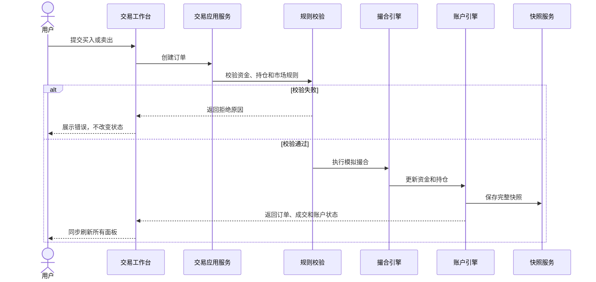
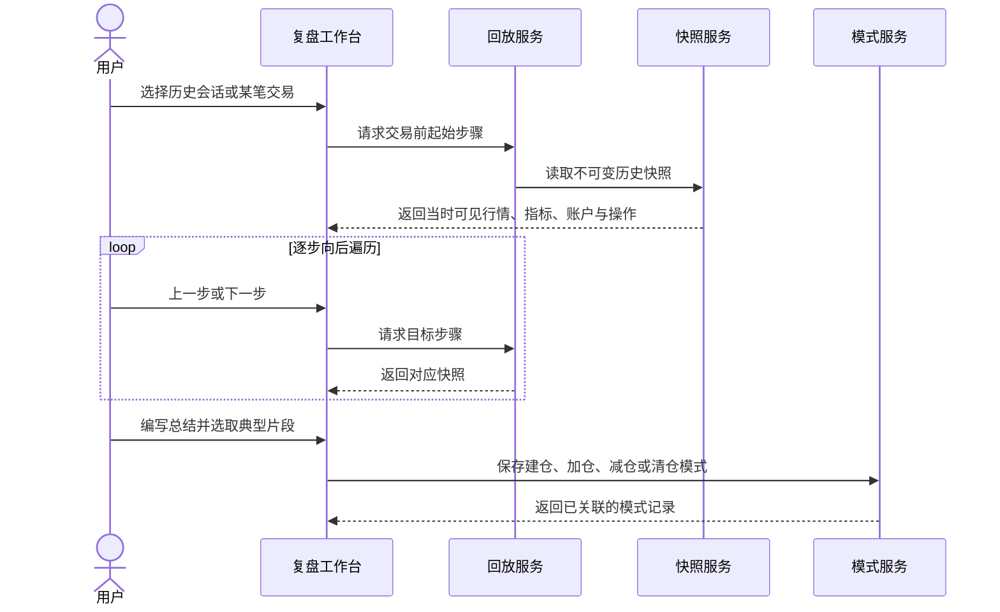
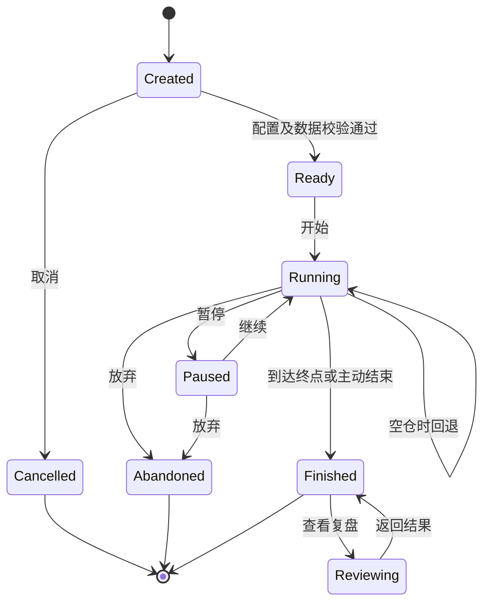

# 股票买卖训练助手概要设计

## 1. 文档信息

| 项目 | 内容 |
| --- | --- |
| 文档版本 | 1.0 |
| 系统名称 | 股票买卖训练助手 |
| 一期重点 | 随机日线训练闭环 |
| 目标用户 | 希望通过历史行情训练交易决策和仓位管理的个人投资者 |
| 文档用途 | 产品确认、架构评审、开发拆分、测试验收 |

## 2. 产品目标与范围

系统在未知未来行情的条件下，使用历史K线模拟交易，训练用户的看盘判断、买卖决策、仓位管理和复盘能力。

核心原则：

1. 客户端只能获得当前训练步骤及之前的行情，不能泄露未来数据。
2. 每次随机训练都记录随机种子，可完整复现。
3. 订单、成交、资金、持仓和快照使用统一业务引擎计算。
4. 每个用户操作必须产生明确结果或明确拒绝原因。
5. 训练完成后必须可以回放、统计和复盘。

一期范围：随机训练配置、日线行情、日周月周期切换、可配置指标、K线逐根推进、市价买卖、观望、受限回退、账户持仓、交易明细、训练结算、逐步复盘与交易模式沉淀。

一期不包含：实盘交易、行情实时订阅、融资融券、做空、多人社交、付费体系和公开排行榜。

## 3. 角色与使用场景

### 3.1 角色

- 训练用户：配置训练、执行交易、查看结果、进行复盘。
- 数据管理员：导入与校验行情数据，维护股票基础信息和交易日历。
- 系统管理员：维护系统参数、交易费率和市场规则。

### 3.2 核心场景

1. 用户选择随机训练，配置市场、周期、年份和复权方式。
2. 系统随机选择满足条件的股票与连续150根K线。
3. 用户在逐步揭示的行情上买入、卖出或观望。
4. 系统模拟撮合并实时更新账户、持仓和盈亏。
5. 用户回退到上一完整快照，或继续推进至训练结束。
6. 系统结算并生成交易表现和行为复盘报告。
7. 用户选择历史会话或某笔交易，逐步回放当时可见行情与操作，并提取建仓、加仓、减仓和清仓模式。

## 4. 功能架构

## 5. 功能模块

| 一级模块 | 子模块 | 一期 | 主要职责 |
| --- | --- | --- | --- |
| 用户账户 | 初始资金、余额重置、偏好设置 | 是 | 管理训练账户基础配置 |
| 行情数据 | 导入、校验、复权、周期转换 | 是 | 提供可信且连续的历史行情 |
| 训练模式 | 随机、指定、双盲、裸K、趋势训练 | 随机 | 生成不同训练场景 |
| 训练配置 | 市场、周期、年份、复权、长度 | 是 | 形成可校验的训练参数 |
| 交易工作台 | 图表、时间推进、交易、账户、明细 | 是 | 承载训练全过程 |
| 多周期图表 | 日线、动态周线、动态月线 | 是 | 在同一训练日期下切换观察周期，不泄露未来行情 |
| 技术指标 | 指标开关、MA参数配置 | 是 | 按当前显示周期计算并展示可配置指标 |
| 交易引擎 | 订单校验、撮合、费用、资金与持仓 | 是 | 保证交易结果一致、可测试 |
| 过程控制 | 开始、暂停、推进、受限回退、结束 | 是 | 管理训练生命周期；持仓期间禁止回退 |
| 逐步复盘 | 交易选择、逐步回放、交易点、心得与总结 | 是 | 还原每一步当时可见的行情、指标和账户状态 |
| 交易模式库 | 建仓、加仓、减仓、清仓模式 | 是 | 从历史片段沉淀个人交易规则并关联证据 |
| 历史统计 | 会话列表、详情、筛选、个人统计 | 部分 | 保存并查询历史表现 |
| 排行榜 | 收益与风险调整排名 | 否 | 多用户比较 |

## 6. 核心业务流程

### 6.1 随机训练流程

### 6.2 训练交互流程

训练日期始终按日推进。切换周线或月线只改变展示聚合方式；当前未完成的周K、月K及其MA会随每个新交易日动态变化。存在持仓且评测未结束时，客户端禁用回退，服务端必须再次校验并拒绝绕过请求。

### 6.3 逐步复盘流程

## 7. 系统架构

### 7.1 推荐技术路线

- 客户端形态：CS桌面应用。
- 界面：Vue 3 + TypeScript。
- 桌面容器：优先Tauri，备选Electron。
- 图表：TradingView Lightweight Charts或ECharts。
- 核心引擎：独立TypeScript领域包，不依赖UI。
- 本地数据库：SQLite。
- 数据清洗：Python离线工具，不承担界面业务。
- 测试：Vitest、Playwright和数据库集成测试。

如必须采用Python主导，可替换为PySide6 + Python领域引擎 + SQLite；业务分层和数据模型保持不变。

### 7.2 分层职责

| 层 | 职责 | 禁止事项 |
| --- | --- | --- |
| UI层 | 展示状态、接收输入、呈现错误 | 直接计算资金、持仓或成交 |
| 应用服务层 | 编排用例、事务和权限 | 持有复杂交易算法 |
| 领域层 | 交易规则、状态迁移、指标计算 | 依赖具体页面或数据库实现 |
| 基础设施层 | 数据库、文件、日志、行情导入 | 决定业务规则 |

### 7.3 数据安全与一致性

- 前端接口只返回 `visibleIndex` 以内的K线。
- 周线、月线及所有指标必须由 `visibleIndex` 以内的日线实时聚合，禁止使用完整自然周或自然月的未来数据。
- 写交易、更新账户、写流水和保存快照必须处于同一事务。
- 复盘使用训练过程中形成的不可变历史快照，不得用当前规则重新推算并覆盖历史事实。
- 金额使用定点小数或整数分，禁止使用二进制浮点直接结算。
- 所有写操作携带会话版本号，防止重复点击和并发覆盖。
- 随机训练保存随机种子、候选规则和最终选择结果。

## 8. 训练状态机

## 9. 非功能要求

- 正确性：资金、持仓、费用与绩效计算的单元测试覆盖率不低于90%。
- 性能：150至2000根K线初次绘制不超过500毫秒，推进单步反馈不超过100毫秒。
- 可恢复性：应用异常退出后可恢复最近一次已提交快照。
- 可审计性：每次状态变化可关联订单、成交、资金流水和训练步骤。
- 可用性：所有主要按钮必须有加载、成功、失败或禁用状态。
- 兼容性：桌面最小宽度1024px；移动端只作为查看和轻量操作补充。

## 10. 一期验收标准

1. 随机训练配置能够真正影响抽取结果。
2. 相同数据、配置和随机种子得到相同训练场景。
3. 用户无法通过客户端获得未来K线。
4. 买入、卖出、观望、推进和回退形成完整闭环。
5. 资金不足、持仓不足、非法手数等操作被拒绝并展示原因。
6. 账户、持仓、图表和交易明细始终同步。
7. 训练结束后生成正确的收益、胜率、盈亏比和最大回撤。
8. 核心单元测试、集成测试和端到端流程测试全部通过。
9. 持仓且评测未结束时，前端和服务端均禁止回退；恢复空仓后按配置允许回退。
10. 日线、周线和月线切换保持同一训练日期，未完成周K、月K及其MA每日动态更新。
11. MA支持开关及自定义周期，计算只使用当前训练日期及以前的数据。
12. 复盘可以选择历史交易逐步向后遍历，并保存逐步笔记、整体总结及四类交易模式。

## 11. 迭代计划

1. 领域基础：行情模型、账户、订单、成交、费用和快照。
2. 随机训练：配置校验、候选筛选、随机种子和场景创建。
3. 工作台闭环：多周期图表、动态指标、推进、买卖、观望和受限回退。
4. 逐步复盘：快照回放、交易点、逐步笔记和整体总结。
5. 模式沉淀：建仓、加仓、减仓、清仓模式及历史证据统计。
6. 模式扩展：指定、双盲、裸K、趋势和量价训练。
7. 平台能力：历史统计、排行榜、同步和数据管理。

详细字段、接口、算法与测试设计见《股票买卖训练助手详细设计》。
